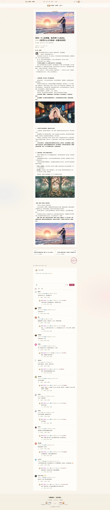
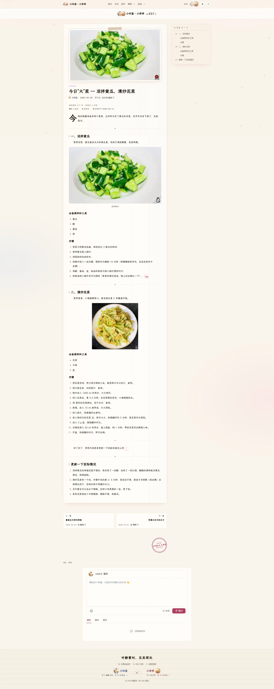
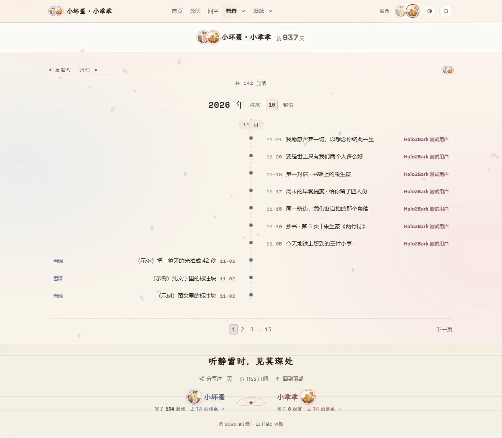
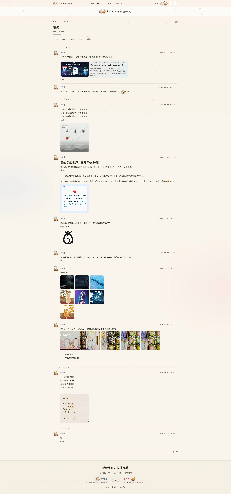

# 双星记（theme-twinstar）

> 两个人，书信往来：**两地书**——双墨署名贯穿全站，文章流左右分侧，
> 中缝装订线把「我们」的部分装在正中间；每一篇都写于「在一起的第 N 天」。

双人署名与对页信流、报头「在一起第 N 天」、信 / 相 / 瞬间库存、随机旧信与时间胶囊；
内置瞬间时间线、相册灯箱、四版式首页与自动目录，后台分组可调，未装插件自动缺项。

**当前版本：0.1.1** · 发布地见 [发布一个情侣主题——《双星记》](https://wuqishi.com/archives/theme-twinstar)

## 概念

双星记不做风景博客，也不做通用博客。整站是一本
**「两个人对写的信笺」**——主题是博客的外衣，两个人是字，信是纸：

- **双墨**：A 靛墨、B 胭脂墨，两套墨系贯穿署名、链接、封条与库存数字——
  页面任何时刻都是两套墨在对话（双人色系从设置里的署名色自动派生）。
- **双侧**：文章流按作者左右分侧靠齐，同人连写自然聚块——不对称来自真实数据，
  不是装饰错位；单作者自动切「单墨模式」（单栏收中）。
- **中缝**：首页信流与归档「对写年轮」的中缝装订线，是「我们」的空间——
  库存、随机旧信、时间胶囊、那年今天都住在缝上。
- **信为纸**：拆信编排（信纸展开/折痕光带/首字沉墨）、邮戳日期、圆形朱印、
  可收藏的打印信全部保留——信怎么写不重要，重要的是谁写给谁。
- **归属零门槛**：设置里**下拉直选**两位的账号（原生 userSelect）；什么都不填也行——
  显示名与人设名沾边就自动归侧（双向模糊匹配），单作者/未识别文章自动兜底。

## 特性

- **首页列表四版式**：Console 一键切换——双侧信流（默认）／信笺对页／明信片双列墙／邮票整版（票面面值位 = 恋爱天数）；分类/标签页自动获得同质感的明信片小墙。列表还可关摘要、切「舒展/紧凑」，双侧信流的头版也能单独关闭。

- **报头**：居中刊头读站点名、双人头像对（交叠心）、双墨报名、
  「在一起的第 N 天」大数字 + 「这个家的库存」横排
  （N 封信 · M 张相片 · K 个瞬间，未装插件自动缺项）。

- **照片夹页**：文章封面（post.spec.cover）走白边相纸 + 微倾的照片卡，
  照片统一 16:10 裁切、上限 168px；带照片的卡摘要收成一行，与纯文字卡节奏齐平。

- **头像签名章**：卡片与信头的作者章按「作者头像 > 人设 emoji > 首字」三态显示，
  头像 404 自动降级；文章页/上下篇/归档/页脚全站同一套署名编码。

- **对写年轮**：归档中缝主轴、双侧条目骑缝色点、年标「这一年，往来 N 封」；
  月份小签分段，页首只报「共 N 封」，页码交给页尾分页窗。

- **署名对照上下篇**：上一篇/下一篇按作者关系标注——同一位写就低调，
  另一位写就「{名字} 写的」+ 对方墨色。

- **那年今天**：往年今天写过的文章自动出现在页底横条（邮戳圆章样式）。

- **时间胶囊 🔒**：到期前任何页面都不输出信文（模板层拦截）；胶囊页倒计时。

- **信头系统**：letter_to 渲染「——写给 XX」；co_authored 双人合写署名。

- **圆形朱印**：滚到文末揭印——「本章由 TA ♥ TA 共同见证」，姓名整行不拆。

- **隔日想起**：那年今天、随机旧信与「下一个纪念日」都可单独关闭，不打扰日常阅读。

- **长信目录**：文章页按正文 h2/h3 自动生成「信内索引」——桌面为信纸右侧的吸顶索引卡，
  当前小节带 A→B 渐变书签；移动端折成可展开卡片；标题少于两个时整块隐藏。
  无目录时正文保持 760px 居中阅读列。

- **信纸封面**：文章设了封面时，以「相纸 + 和纸胶带 + 蜡封心」压在信纸上缘；
  后台可一键关闭，无封面文章自然回到纯文字信头。

- **信字统计**：信头下方显示「约 N 字 · 读完约 N 分钟」，后台可关。

- **信笺账本**：统计之下读出「N 人读过 · N 封回信 · 最后誊抄于 YYYY-MM-DD」——
  回信数随评论开关隐藏，最后誊抄只在改过且跨天时出现。

- **分享这一页**：页脚一键调用系统分享面板；不支持时复制当前链接并轻提示。

- **页脚三段式**：完整 / 精简 / 极简三种长度，口号可独立关闭；页脚不再重复站内导航；
  默认精简；完整版也收成「单行双人署名 + 中央纹章」，不再纵向拖长。

- **今日签**：手写句子 + 内置情话池按日轮换；可选接公共情话 API（例如
  `https://v1.hitokoto.cn/?c=d&c=i&encode=json`，按天缓存、跨域或超时静默回退），
  访客点「换一句」即可翻页。

- **图片灯箱**：瞬间页按张数自适应网格，图片统一铺满相框，
  点开可左右翻页、键盘 ←/→、触屏滑动；相册页共用同一套灯箱。

- **瞬间时间线**：A/B 署名色轨道 + 月份刻度 + 悬停浮纸；时间戳直达详情、
  标签即点即筛，触屏下放大镜常驻，详情页顶部与底部都能返回。

- **可收藏的信**：Ctrl+P 直接打印——白纸黑字，朱印预先揭好。

- **纸面身份带**：页顶细条只在非首页出现，读头像对/双人名/恋爱天数，
  纯纸面墨色分隔，氛围交给信纸本身。

- **台灯夜读暗纸**：color_scheme=auto 跟随系统深浅，dark 可手工常暗（暖黑，不泛紫）；
  访客也能在顶栏随时切换「跟随系统 / 浅色 / 深色」，选择记在本机。

- **归档更完整**：分类总览按树展开子分类（子级缩进 + 虚线引导）；分类与标签页头可放 4:3 小相片，
  标签色作为页头短墨线与账簿圆点；作者页显示个人资料简介，合写文章可点进各自信桌。

- **站点信息**：文章可自定义 head Meta（htmlMetas）；菜单项支持新窗口打开；
  页脚落款可显示站点副标题（与自定义页脚文案重复时自动隐藏）。

- **插件生态**：友链星球页、瞬间流、相簿、一键搜索——未装不影响（自动缺项）。

- **社交分享**：og/Twitter Card + JSON-LD（开关防冲突）；RSS autodiscovery。

- **数字邮政身份**：全站数字（天数/日期/库存/信龄）统一 Space Mono。

## 界面一览

### 首页四种版式

| 版式             | 结构                                       | 适合                       |
| ---------------- | ------------------------------------------ | -------------------------- |
| 双侧信流（默认） | 双列信流按作者左右分侧，最新一封头版跨双栏 | 两人都常写，想看「谁写的」 |
| 信笺对页         | 左右页装订，轮流或按作者分侧，带照片夹页   | 想要书页感、照片多         |
| 明信片双列墙     | 等宽双列卡片，封面统一                     | 内容密度均匀、以图为主     |
| 邮票整版         | 邮票格排列，票面面值 = 恋爱天数            | 收藏感、篇数多时好看       |

**双侧信流（默认）**

**信笺对页**

**明信片双列墙**

**邮票整版**

### 其他页面

**文章页**：信笺、目录与信笺账本

**归档**：对写年轮

**分类总览**：分类树

**作者页**：TA 的信桌

**瞬间**：时间线

**相册**：灯箱网格

**夜读**：暗纸配色

**移动端**：390px

## 环境要求

- Halo **≥ 2.27.0**（菜单安全读取与页面布局契约依赖 2.27 起的行为）；
- 评论区需安装任意兼容 `halo:comment` 扩展点的评论组件插件（如官方评论组件）——
  未装时评论区自动留空，其余页面不受影响；
- 友链、瞬间、相册、搜索均为**可选插件**，未装自动缺项，不影响首页与文章页。

## 安装与启用

1. **应用市场安装**：Halo Console → 应用市场，搜索「双星记」一键安装（上架后可用）；
2. **手动安装**：Console → 外观 → 主题 → 安装，上传主题 zip 包；
3. 在「外观 → 主题」中**启用**双星记；
4. 进入「外观 → 主题 → 设置」开始配置（共 8 组，见下）。

## 快速上手：配好「两个人」

1. **起名字**：设置 → 「两个人的身份」→ 分别填写两位的人设名（如「小坏蛋」/「小乖乖」）、
   各自的 emoji 与署名色（全站双墨由这两个色派生）；
2. **认账号**：同组下方用 **userSelect 下拉直选**两位的 Halo 账号——选中后文章自动按作者
   左右分侧、页脚自动统计「写了 N 封信」；
3. **什么都不填也能用**：只填人设名时，显示名与人设名沾边的文章自动归侧；
   完全不填则全站中性墨兜底，不会破版；
4. **定日子**：设置 → 「日子与情话」→ 填「在一起的第一天」（恋爱天数与信笺编号同源）；
   固定时区保证海外访客看到的数字一致。

## 基本配置（8 组速览）

| 设置组 | 管什么 |
| --- | --- |
| 外观与排版 | 明暗三态（跟随系统/浅色/深色）、主色、标题字体、字号缩放、纸面颗粒 |
| 两个人的身份 | 人设名、头像、emoji、署名色、报头心形与后缀、作者绑定（userSelect） |
| 日子与情话 | 纪念日（恋爱天数）、时区、庆祝日、里程碑、今日签与情话 API |
| 首页与列表 | 四版式切换、对页分侧模式（轮流/按作者）、摘要与密度、频道筛选、空位信笺 |
| 文章阅读 | 信纸封面、信内目录、信字统计与信笺账本 |
| 导航与页脚 | 菜单选择、页脚三段式（完整/精简/极简）、自定义口号 |
| 动效与氛围 | 动效等级、花瓣氛围场景、鼠标指针、顶栏自动隐藏 |
| 搜索与分享 | og/Twitter Card、JSON-LD 结构化数据（开关防冲突） |

## 文章注解

在文章编辑器的「设置 → 注解」中填写，主题据此渲染特殊信头与玩法：

| 注解 | 作用 |
| --- | --- |
| 信头 · 写给 | 信头渲染「——写给 XX」 |
| 双人合写 | 选「是」后署名显示两位并计入双方信桌 |
| 胶囊 · 启封日 / 写给谁 / 信文 | 时间胶囊三件套：到期前任何页面都不输出信文，到期自动解锁 |
| 里程碑 · 日期 / 标语 / emoji | 把一篇文章标成「我们的故事」时间轴上的一个节点 |

**时间胶囊页**：新建独立页时在「模板」中选择「时间胶囊」；「我们的故事」同理
（模板下拉：时间胶囊 / 我们的故事 / 搜索页）。

## 可选插件

| 插件 | 装了获得 | 未装表现 |
| --- | --- | --- |
| PluginPhotos（相册） | /photos 相册页 + 单张详情（灯箱、EXIF） | 报头库存自动缺项，无相册入口 |
| PluginMoments（瞬间） | /moments 时间线 + 详情页 | 同上 |
| PluginLinks（友链） | /links 星球友链墙（分组 + 描述 + 落点） | 同上 |
| PluginSearchWidget（搜索） | /search 搜索页（顶栏搜索可用） | 搜索入口不可用 |
| 评论组件（任意兼容 halo:comment 的插件） | 文章/页面评论区 + 信笺账本回信数 | 评论区留空，账本隐藏回信数 |

## 常见问题

**只有我一个人写，会破版吗？**
不会。单作者自动切「单墨模式」（单栏收中，中缝装饰隐藏）；另一侧还可显示
「待写的信」空位信笺（可在设置中关闭）。

**为什么 TA 的文章没有染上 TA 的墨色？**
文章作者的显示名要与人设名沾边（双向包含即自动归侧）；拿不准就在设置里用
userSelect 直接绑定账号，显式绑定优先级最高。

**目录一直不显示？**
信内目录要求正文里至少两个 h2/h3 标题；不足时整块隐藏，正文回到居中阅读列。

**海外访客看到的「第 N 天」不一样？**
在「日子与情话」里固定时区（默认 +08:00），全站天数按此时区计算，所有人看到同一个数字。

**评论区是空的？**
安装一个兼容 `halo:comment` 的评论组件插件；评论开关受 Halo 评论设置与文章本身的评论开关共同控制。

**想打印一封信？**
Ctrl+P / ⌘+P——打印样式已内置：白纸黑字、氛围元素隐去、朱印预先揭好。

## 许可

[MIT](LICENSE)
